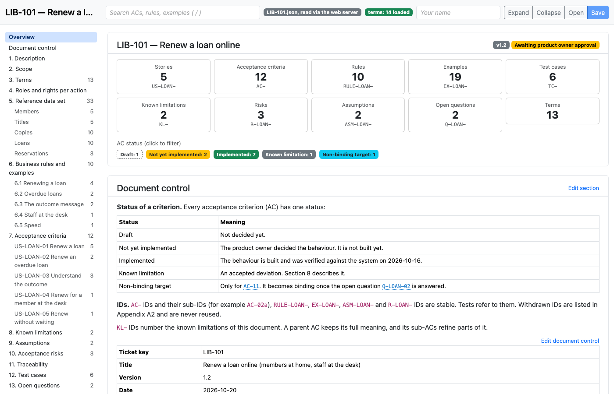
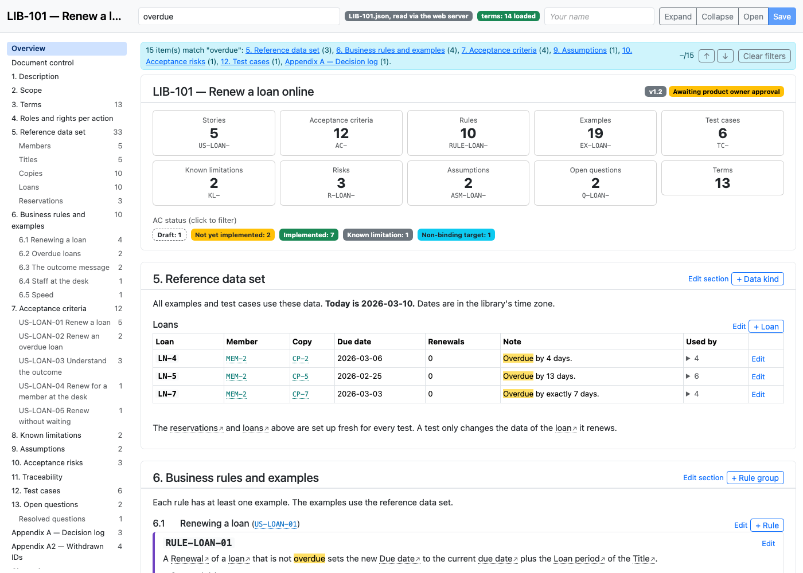
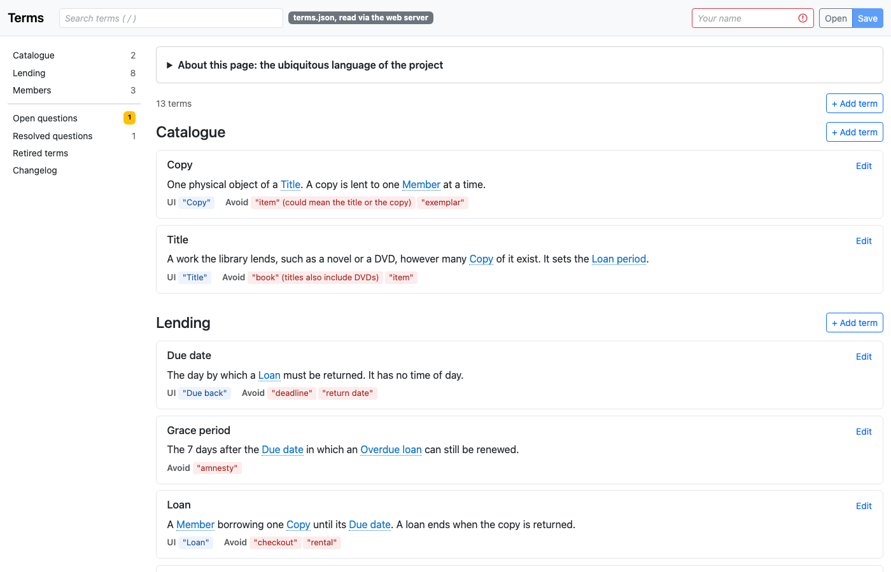

<p align="center"></p>

# Specification by Example

A small, dependency-free toolkit for writing **living requirements** as plain JSON files, in the spirit of
[Specification by Example](https://gojko.net/books/specification-by-example/) and Domain-Driven Design's
*ubiquitous language*.

You keep two kinds of files in your repository:

| File | What it holds | Viewer / editor |
|---|---|---|
| `terms/terms.json` | The **terms** of your domain: one shared vocabulary, defined once | `terms.html` |
| `specs/<TICKET>.json` | One **specification per ticket**: stories, business rules, concrete examples, acceptance criteria (Gherkin), test cases, risks, decisions | `specs.html` |

**requiremento** is the tool around them: a command line, two single-file HTML pages to read and edit the files, and the
checks. It is an npm package without dependencies. The tool and your data are separate: the tool is installed at a
version you choose, your files stay in your repository, and a small `requiremento.json` says where. Upgrading the tool never
touches your data.

The JSON is the source of truth, so it diffs, reviews and merges like code, and people and scripts can edit it.
The repository of requiremento has a complete worked example (`examples/library/`: renewing a library loan) that uses every
feature.

---

## Contents

- [Why](#why)
- [What it looks like](#what-it-looks-like)
- [Getting started](#getting-started)
- [Commands](#commands)
- [Your project](#your-project)
- [The terms file](#the-terms-file)
- [The specification file](#the-specification-file)
- [IDs](#ids)
- [Links and Markdown](#links-and-markdown)
- [Checks](#checks)
- [Editing: people, scripts and AI agents](#editing-people-scripts-and-ai-agents)
- [Rolling it out in a team](#rolling-it-out-in-a-team)
- [Upgrading](#upgrading)
- [Browser support](#browser-support)
- [FAQ](#faq)
- [Contributing and license](#contributing-and-license)

---

## Why

Requirements tend to rot. A rule lives in a ticket, an example in a chat, the test in someone's head, and the same word
means three things. This toolkit pushes against that with a few simple ideas:

1. **Rules come with examples.** A business rule without a concrete example is not accepted by the checker.
   Examples use named reference data (`MEM-1`, `LN-4`), so everybody discusses the same case.
2. **Examples drive acceptance criteria and tests.** Each acceptance criterion points to the rules and examples it
   makes testable, and each test case points to the criteria it covers. Traceability is generated, not maintained.
3. **One vocabulary.** Terms are defined once and linked (`[[loan-period]]`) from specs. Retired terms warn,
   forbidden synonyms are recorded.
4. **IDs are forever.** Tests, tickets and reviews refer to IDs, so an ID is never renamed or reused. It is withdrawn.
5. **Plain files.** JSON in git, one stable key order, so every change shows up as a small diff.

## What it looks like

`requiremento serve` shows your JSON files as readable pages. The pages are also the editor.

**A specification** with its overview, the table of contents and a status filter for the acceptance criteria:



**Search and reference data.** Every mention of a reference data item (`LN-4`, `MEM-2`) or a term links to its item. The
search highlights matches across the whole spec:



**The terms** of the domain, defined once. The words to avoid are listed next to each definition:



## Getting started

You need Node 18 or newer, and Chrome or Edge to edit comfortably. Run this in the folder where the requirements
should live, usually the root of your repository:

```bash
npm install --save-dev requiremento@0.1.0   # pin the version you want
npx requiremento init                       # creates requiremento.json and an empty terms file; asks about AGENTS.md / CLAUDE.md
npx requiremento new SHOP-42 "Checkout"     # creates an empty spec for a ticket
npx requiremento serve                      # shows the pages at http://localhost:8000
```

Open `http://localhost:8000`, pick the terms or the spec, and start writing. Every change in the pages adds a
changelog entry. Commit the JSON files like any other source.

No `package.json` (for example in a Gradle or Maven project)? Use `npx requiremento@0.1.0 <command>` instead. It needs only
Node, and the version in the command is the version you get.

The pages load Bootstrap from a CDN, so you need to be online for the styling the first time.

## Commands

| Command | What it does |
|---|---|
| `requiremento init [--agents agents\|claude\|both\|none]` | Creates `requiremento.json` and an empty terms file. Existing files are kept. It also asks whether to add a short section for AI agents to `AGENTS.md`, `CLAUDE.md` or both (see [Editing](#editing-people-scripts-and-ai-agents)). The flag answers the question up front; without a terminal and without the flag, nothing is added. |
| `requiremento new <KEY> ["title"]` | Creates an empty spec file for a ticket, for example `SHOP-42`. |
| `requiremento check [spec.json ...]` | Checks the terms file and the given spec files (default: all of them). Exit code 1 on errors, so it works as a CI step. See [Checks](#checks). |
| `requiremento serve [--port 8000]` | Starts a local web server that shows the pages on your files. Press Ctrl+C to stop. |
| `requiremento guide` | Prints the guide for AI agents: the file formats, the ID rules and the workflow. See [Editing](#editing-people-scripts-and-ai-agents). |
| `requiremento schema <specs\|terms>` | Prints the JSON Schema of a spec or the terms file. |
| `requiremento --version`, `requiremento --help` | |

`requiremento serve` only reads your files. *Save* in the pages writes into the file with the File System Access API (Chrome
or Edge; see [Browser support](#browser-support)). The pages are in `node_modules/requiremento/pages/`, so you can also open
them straight from disk, click *Open* once and pick the JSON file.

## Your project

The tool adds no files to your project except the config. This is all of it:

```
your-project/
  requiremento.json            { "terms": "terms/terms.json", "specs": "specs" }
  terms/terms.json
  specs/SHOP-42.json
```

### The config file

`requiremento.json` is looked up in the current folder and then in each parent folder, like `package.json`. Both keys are
optional; the values below are the defaults. Paths are relative to the config file.

| Key | Meaning | Default |
|---|---|---|
| `terms` | The terms file | `terms/terms.json` |
| `specs` | The folder with the spec files (every `.json` file there that uses the specs schema) | `specs` |

To keep the requirements elsewhere, change the config and move the files, for example
`{ "terms": "docs/terms.json", "specs": "docs/requirements" }`. Without a `requiremento.json`, the defaults apply relative to
the current folder.

## The terms file

`terms/terms.json` has four parts:

| Key | Content |
|---|---|
| `groups` | Sections of the page (`id`, `title`), sorted by title |
| `terms` | The terms, sorted by group, then by name |
| `questions` | Open and resolved questions about terms (`Q-01`, ...) |
| `changelog` | Append-only history, oldest first |

A term:

```json
{
  "id": "loan-period",
  "term": "Loan period",
  "group": "lending",
  "definition": "The number of days a [[copy]] is lent for, set per [[title]]. A novel is 21 days, a DVD 7 days.",
  "uiLabel": "\"Lending time\"",
  "avoid": ["\"borrowing period\" (ambiguous: the time a member has had the copy)"],
  "status": "active"
}
```

- `id` is a lowercase slug and a stable anchor (`terms.html#loan-period`). Never change it.
- `term` is the word to use in specs, tests and code.
- `uiLabel` is what the user sees, if that differs from the term (for example because the UI is in another language).
- `avoid` lists synonyms that must not be used, with an optional reason.
- `status` is `active` or `retired`. A retired term needs `replacedBy` (a term id or free text) and may have `retiredSince`.
- Inside `definition`, `[[term-id]]` links another term and shows its current name, and `` `code` `` is shown as code.

**Questions** capture undecided meaning, so it doesn't leak into a definition. A question lists the terms it concerns
and is `open` until it has a `resolution`.

## The specification file

One file per ticket. The key order is fixed and the file ends with a newline; `specs.html` writes it in exactly that
format. Top-level keys:

| Key | Content |
|---|---|
| `meta` | Ticket key, titles, version, date, approval, related documents, `precedence` statement |
| `sections` | The page, in order: Markdown text and an optional generated list (`"list": "rules"`, `"data"`, ...) |
| `terms` | Ids of the terms the spec relies on (definitions live only in the terms file) |
| `dataKinds`, `data` | **Reference data** that examples and tests use: kinds with columns, and the items |
| `stories` | User stories (`US-...`) with a readiness note |
| `ruleGroups`, `rules` | Business rules (`RULE-...`), grouped under a story |
| `examples` | Concrete examples (`EX-...`), each belonging to one rule |
| `acceptanceCriteria` | ACs (`AC-...`): status, rules, examples, Gherkin scenarios |
| `testCases` | Test cases (`TC-...`): steps, covered ACs, status, automation reference |
| `limitations`, `assumptions`, `risks` | Accepted deviations (`KL-...`), assumptions (`ASM-...`), risks (`R-...`) rated 1 to 3 |
| `questions`, `decisions` | Open questions (`Q-...`) and a dated decision log |
| `withdrawn` | IDs that must never be reused |
| `changelog` | Append-only history: date, author, action, ref, summary |

### How the pieces fit

```
Story ──► Rule group ──► Rule ──► Example ──┐
  │                        │                │
  └──────────► Acceptance criterion ◄───────┘      (lists its rules and examples,
                   │                                holds the Gherkin scenarios)
                   ▼
              Test case                            (lists the ACs it covers)

Reference data (MEM-1, LN-4, ...) is mentioned in examples, scenarios and tests,
and every mention becomes a link.
```

### An example, end to end

A **rule**:

> `RULE-LOAN-05`: An overdue loan can be renewed only within the grace period: up to and including the 7th day after
> its due date.

Its **examples**, using reference data (`LN-7` is a loan that is overdue by exactly 7 days, `LN-5` by 13 days):

> `EX-LOAN-09`: MEM-2 renews LN-7, which is overdue by exactly 7 days. The renewal is allowed: the 7th day still counts.
> `EX-LOAN-10`: MEM-2 renews LN-5, which is 13 days overdue. The renewal is refused with the reason "grace period".

An **acceptance criterion** that makes them testable:

```gherkin
Scenario: Overdue by more than 7 days
  Given LN-5 is overdue by 13 days
  When MEM-2 renews LN-5
  Then the renewal is refused
  And the message says "This loan is too late to renew. Please return the copy."
```

A **test case** (`TC-04`) covers `AC-05` and `AC-06`, with boundary values at 4, 7 and 13 days. The page shows the
whole chain in both directions: from a rule to its examples and ACs, and from a test case back to the story.

### Acceptance criterion statuses

| Status (`status`) | Meaning |
|---|---|
| `draft` | Not decided yet |
| `pending` | Decided, not yet implemented |
| `implemented` | Built and verified |
| `known-limitation` | An accepted deviation, described in a `KL-` item |
| `target` | A non-binding target, for example a performance goal waiting for a decision |

Test cases have the statuses `draft`, `ready`, `passed`, `failed` and `blocked`.

### Reference data

Examples are much easier to follow when they share a small, named data set. Declare **kinds** (with columns) and
**items**:

```json
"dataKinds": [
  { "id": "loan", "label": "Loan", "title": "Loans", "columns": ["Member", "Copy", "Due date", "Renewals", "Note"] }
],
"data": [
  { "id": "LN-1", "kind": "loan", "values": { "Member": "MEM-1", "Copy": "CP-1", "Due date": "2026-03-12", "Renewals": "0" } }
]
```

- Every mention of `LN-1` in any text becomes a link to the item, also inside other data items.
- A kind can have **derived columns** that list the items of another kind pointing at it (the loans of a member).
- `"testOnly": true` marks an item that only test cases use.
- The checker warns about an item that nothing uses, and fails on a mention of an unknown item with a known prefix
  (`LN-99` when `LN-1` exists), which catches typos.

## IDs

IDs are stable. Never change or reuse one; **withdraw** it (it moves to `withdrawn`).

| Item | Pattern | Examples |
|---|---|---|
| Spec items (stories, rules, examples, ACs, test cases, limitations, assumptions, risks, questions) | `^[A-Z]+(-[A-Z]+)*-[0-9]+[a-z]?$` | `AC-01`, `AC-02a`, `RULE-LOAN-03`, `EX-LOAN-12`, `TC-04`, `KL-01`, `Q-LOAN-02` |
| Reference data | `^[A-Z][A-Z0-9]*(-[A-Za-z0-9]+)*$` | `MEM-1`, `LN-4`, `CP-3a1` |
| Terms, sections, data kinds | lowercase slug | `loan-period`, `reference-data` |
| Rule groups | free text | `6.1` |

- An area part such as `LOAN` is optional and up to you. `AC-02a` is the convention for an AC inserted after `AC-02`.
- A reference data ID must not look like a spec ID. Keep different prefixes (`LN-`, not `AC-`).
- Items of one data kind should share a prefix, so the checker can spot unknown mentions.
- In `withdrawn`, a range can be written as `EX-LOAN-90..EX-LOAN-92`.

## Links and Markdown

All text fields are Markdown: paragraphs, `-` and `1.` lists, pipe tables, `###` headings, `**bold**`, `*italic*`
and `` `code` ``.

Automatic links:

- IDs of the spec (`AC-02`, `RULE-LOAN-03`) and of reference data (`LN-4`) link to their item, wherever they appear.
- `[[term-id]]` links a term and shows its current name. Rename a term and every spec shows the new name.
- Anything in Gherkin scenarios is linked too. *Copy Gherkin* on an AC copies its scenarios as a `.feature` file.

Permalinks: `specs.html#AC-02a` opens an item, `specs.html#LN-4` a data item, `terms.html#loan-period` a term.

## Checks

The JSON Schema describes shape. `requiremento check` covers what a schema can't. Run it in CI, in a pre-commit hook, or after
any hand or script edit. The pages run the same checks before they save.

```bash
npx requiremento check                       # the terms file and every spec file named by requiremento.json
npx requiremento check specs/SHOP-42.json    # only the given spec files (the terms file is still used)
```

Exit code 1 on errors.

**Terms: errors**

- duplicate or malformed IDs, unknown groups
- empty term or definition
- retired term without `replacedBy`
- `[[links]]` to unknown terms (also in questions)
- resolved question without a resolution
- groups or terms out of order, bad changelog dates

**Specs: errors**

- duplicate IDs, malformed IDs, reuse of a withdrawn ID
- broken references (an example's rule, an AC's story, a test case's AC, ...)
- a rule without an example, an example no AC uses
- an AC with neither scenarios nor a description, scenarios not starting with `Scenario:` or `Scenario Outline:`
- mentions of unknown spec IDs or unknown data items in any text
- invalid risk ratings, resolved question without a resolution, bad dates, unknown section lists or data kinds

**Specs: warnings** (do not fail)

- a story without ACs, an unused data item, an AC using an example of a rule it does not list
- terms that are missing in the terms file or retired
- a list with items but no section that shows it
- the file is not in the format `specs.html` writes (the next save from the page reformats it)

The schemas ship with the package. Validate against them with any JSON Schema 2020-12 validator, for example:

```bash
npx ajv-cli@5 validate --spec=draft2020 -s node_modules/requiremento/schemas/specs.schema.json -d specs/SHOP-42.json
npx ajv-cli@5 validate --spec=draft2020 -s node_modules/requiremento/schemas/terms.schema.json -d terms/terms.json
```

## Editing: people, scripts and AI agents

- **People** use the pages. Every change adds a changelog entry with the author's name (asked once and remembered),
  and repeated unsaved edits of the same item are merged into one entry.
- **AI agents** edit the JSON directly. `requiremento init` asks whether to add a short section to `AGENTS.md` (read by
  Codex, Cursor, Copilot and others), to `CLAUDE.md` (read by Claude Code), or to both. It never touches a file you
  decline. The section is about five lines between `<!-- requiremento:start -->` and `<!-- requiremento:end -->`, appended to the
  file if it exists. It tells the agent to run `requiremento guide` before it touches the files and `requiremento check` after.
  Running `init` again updates only the text between the markers, and you can delete the section any time.
  The guide is part of the installed version, so it always matches the format. `requiremento schema specs` and
  `requiremento schema terms` print the schemas, so an agent doesn't have to find them in `node_modules`.
- **Scripts and AI agents** edit the JSON directly, **append a changelog entry themselves**, and run `requiremento check`.
  Keep IDs stable and withdraw instead of deleting. If you write specs with `requiremento/lib/specs-lib.js`, its `serialize(spec)`
  produces the exact key order and formatting the page uses, so diffs stay minimal:

  ```js
  const { check, serialize } = require('requiremento/lib/specs-lib.js');
  const { errors, warnings } = check(spec, terms);
  fs.writeFileSync('specs/SHOP-42.json', serialize(spec));
  ```

- The changelog is append-only. Actions in the terms file: `added`, `changed`, `retired`, `deleted`, `question`.
  Actions in a spec: `added`, `changed`, `withdrawn`, `deleted`, `decision`.

## Rolling it out in a team

1. Install a pinned version and run `requiremento init` (see [Getting started](#getting-started)).
2. Start with the terms. Writing down five terms and their forbidden synonyms resolves more arguments than a dozen
   documents.
3. Create a spec per ticket with `requiremento new`. The file is named after the ticket key (`meta.key`). For a full spec to
   read, see `examples/library/specs/LIB-101.json` in the requiremento repository.
4. Add `npx requiremento check` to CI.
5. Decide on conventions: the area part of the IDs, who may set a spec to `implemented`, and whether the product owner
   approves in `meta.approvedBy` and `meta.approvedOn`.

## Upgrading

Change the version (`npm install --save-dev requiremento@<new version>`, or the version in your `npx` command), then run
`requiremento check`. Your files are not part of the package, so an upgrade never rewrites them. If a release changes the
file format, its release notes say what to change, and the check tells you where.

## Browser support

| Feature | Chrome / Edge | Firefox / Safari |
|---|---|---|
| Read and edit | yes | yes |
| Save directly into the file | yes (File System Access API) | no: *Save* offers a download, replace the file with it |
| Remember the opened file | yes (IndexedDB) | partly |

Files opened straight from disk (`file://`) can't be read by the page by itself, because browsers block that. Pick the
file once, or use `requiremento serve`.

## FAQ

**Why JSON and not Markdown?**
Structure. The checker can tell that an example is unused, an ID is withdrawn, or a test case points to a missing AC.
Markdown stays available inside every text field.

**Why must every rule have an example?**
Because an example is where misunderstandings surface. If nobody can name a concrete case, the rule is not understood yet.

**Can I use my own AC statuses or section layout?**
Sections are free: choose their order, titles and which list each one shows. The statuses of acceptance criteria are
fixed by the tool (see the table above).

**Do I need all the sections?**
No. Leave a collection empty and drop its section. The checker warns only about a non-empty list no section shows.

**Does anything leave my machine?**
No. The pages only read and write the files you pick. The only network request is Bootstrap from a CDN.
Download it and change the `<link>` and `<script>` tags if you need to work offline or behind a firewall.

## Contributing and license

To work on requiremento itself, see [CONTRIBUTING.md](CONTRIBUTING.md). MIT license, see [LICENSE](LICENSE).
